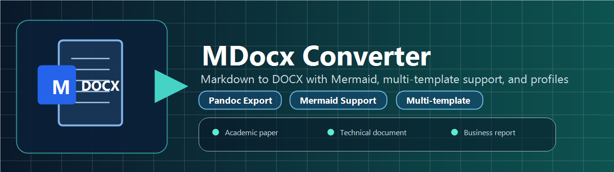
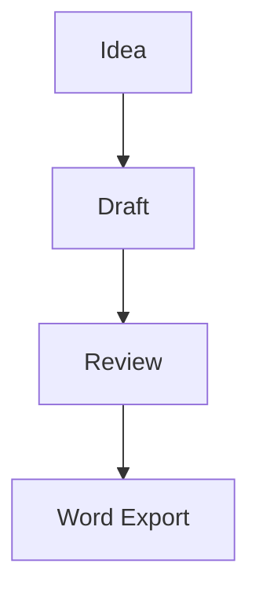
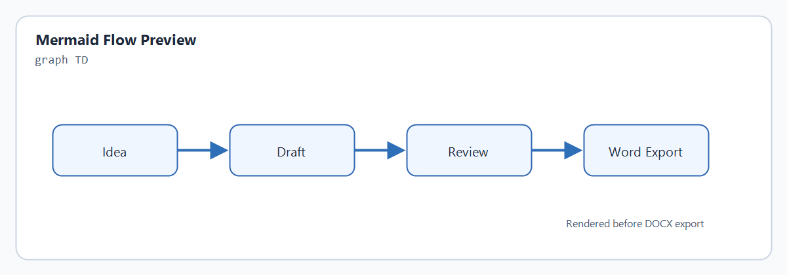

# MD2Docx Converter

[](https://marketplace.visualstudio.com/items?itemName=alexmultiagent.mdocx-converter)
[](https://marketplace.dify.ai/plugin/alexmultiagent/md2docx)
[](https://github.com/AlexMultiAgent/mdocx-converter/releases)



Export Markdown files to DOCX from VS Code with:

- Pandoc-based DOCX generation
- Mermaid code fence rendering
- Built-in English and Chinese reference DOCX files for academic, technical, business, official (GB/T 9704) and thesis (GB/T 7713) exports
- Optional custom `reference.docx` template support
- A cancellable export with live progress
- Helpful diagnostics in the output panel

## Features

- Right-click any `.md` file and export it to `.docx`
- Choose an export submenu type: academic paper, technical document, business report, official document, or thesis
- Watch the export progress in the status bar and cancel it while it runs — a cancelled export leaves no half-written document behind
- Render fenced mermaid diagrams such as:





- Use bundled English and Chinese reference DOCX files matched to document type
- Technical and business templates are standards-derived / guidance-derived reference files, not official template attachments
- Override with a custom Word template via `reference.docx`
- Keep temporary files when debugging conversion problems
- Commands are disabled in untrusted workspaces because exports may run workspace-local Mermaid binaries

## Requirements

### Required

- `pandoc`

Install examples:

```powershell
winget install --id JohnMacFarlane.Pandoc
```

```bash
brew install pandoc
```

The extension does not bundle Pandoc and does not block installation when Pandoc is missing. It checks for Pandoc when you run `Check Export Environment` or `Export Markdown to DOCX`.

### Required only for Mermaid diagrams

- Mermaid CLI: `mmdc`

Install:

```bash
npm install -g @mermaid-js/mermaid-cli
```

If Mermaid CLI is not found and the Markdown file contains ` ```mermaid ` code fences, the default `auto` renderer falls back to the Mermaid Ink API. **The diagram source is then sent to that service** — the extension gives the first notice for each destination origin before sending content there. Set `mdocxConverter.mermaidRenderer` to `local` to keep every diagram on your machine, or to `api` to always use the service. A diagram that fails both ways is kept as a code block instead of failing the export.

## Settings

- `mdocxConverter.pandocPath`
- `mdocxConverter.mermaidCliPath`
- `mdocxConverter.referenceDocx`
- `mdocxConverter.referenceLanguage`
- `mdocxConverter.outputDirectory`
- `mdocxConverter.mermaidOutputFormat`
- `mdocxConverter.mermaidRenderer` (`auto`, `local` or `api`)
- `mdocxConverter.mermaidApiUrl`
- `mdocxConverter.documentTitle`
- `mdocxConverter.openAfterExport`
- `mdocxConverter.keepIntermediateFiles`
- `mdocxConverter.styleProfile`
- `mdocxConverter.bodyFont`
- `mdocxConverter.bodySizePt`
- `mdocxConverter.heading1Font`
- `mdocxConverter.heading1SizePt`
- `mdocxConverter.heading2Font`
- `mdocxConverter.heading2SizePt`
- `mdocxConverter.heading3Font`
- `mdocxConverter.heading3SizePt`
- `mdocxConverter.lineSpacing`
- `mdocxConverter.marginTopMm`
- `mdocxConverter.marginBottomMm`
- `mdocxConverter.marginLeftMm`
- `mdocxConverter.marginRightMm`

Older `paperifyMd.*` settings are still read as a fallback, but new configuration should use `mdocxConverter.*`.

## Style presets

The converter keeps Pandoc and `reference.docx` as the primary DOCX path, then can apply FlexMD-style metadata and DOCX style overrides when you need quick style control.

- `template`: use only the selected reference DOCX
- `academic`: 12 pt body text, 1.5 line spacing, Times New Roman / SimSun paper defaults
- `business`: 11 pt body text, 1.5 line spacing, Arial / Microsoft YaHei report defaults
- `technical`: 11 pt body text, 1.35 line spacing, Arial body text, and Consolas code styles
- `official`: 16 pt FangSong body, a fixed 29 pt line height and GB/T 9704 margins
- `thesis`: 12 pt body text, 22 / 16 / 14 pt headings and GB/T 7713 margins

Use the `Export Markdown to DOCX (MDocx)` submenu from a Markdown context menu to export as `Academic Paper`, `Technical Document`, `Business Report`, `Official Document`, or `Thesis`. These submenu exports force automatic English/Chinese template detection for the current Markdown file.

Use `mdocxConverter.styleProfile` when you want a persistent default:

```json
{
  "mdocxConverter.styleProfile": "business"
}
```

Bundled template mapping follows both language and document type:

- `academic` and `template`: `reference_english_academic.docx` / `reference_chinese_academic.docx`
- `technical`: `reference_english_technical.docx` / `reference_chinese_technical.docx`
- `business`: `reference_english_business.docx` / `reference_chinese_business.docx`
- `official`: `reference_english_official.docx` / `reference_chinese_official.docx`
- `thesis`: `reference_english_thesis.docx` / `reference_chinese_thesis.docx`

Specialized templates do not fall back to the paper templates. If a required bundled template file is missing, export fails with a clear error.

The bundled academic templates are generic academic reference DOCX files written for this extension and are not redistributed journal or conference submission templates. The bundled technical templates are derived from current software and systems documentation guidance such as GB/T 8567-2006, GB/T 32424-2015, ISO/IEC/IEEE 26514:2022, ISO/IEC/IEEE 15289:2019, and ISO/IEC/IEEE 42010:2022. The bundled business templates are derived from current business-plan and project-case guidance such as the NDRC 2023 feasibility-study outline, U.S. SBA business-plan guidance, and HM Treasury Green Book / Five Case Model guidance. These files are practical reference DOCX templates; they are not official Word attachments published by those bodies.

The `official` and `thesis` presets are typography approximations for body text, headings and margins. They are not complete GB/T submission packages with covers, document registers, tables of contents or signature blocks.

## Changelog

### Changes in 0.5.2

- **A document title can no longer run a second command on Windows.** When the Mermaid CLI or a Pandoc shim is a `.cmd`/`.bat`, the argument went through `cmd.exe`; a title that contained a double quote could end the quoted region and let an `&` behind it start a second command. Arguments are now escaped by doubling embedded quotes, so a quote stays inside the quoted region. Covered by a regression test that drives a quote-carrying payload through a real `cmd.exe`.
- **Escaping an argument no longer slows down on a long run of backslashes.** The two regular expressions that escaped the quotes were quadratic; a path with tens of thousands of backslashes could stall the export. The escaping is now a linear character scan.
- The Dify plugin and the VS Code extension still carry the same version line; 0.5.2 ships the security fix on both sides.

### Changes in 0.5.1

- The bundled release notes now cover every change in 0.5.0. The 0.5.0 entry listed six of them; the release itself contained fourteen, including the untrusted-workspace block, the conversion time and output budgets, the Windows filename rules and the style-override ranges.
- The extension is rebuilt with TypeScript 7. The source is unchanged, so the behaviour is the same; only the compiler and its module resolution are newer.
- Every release now also carries a Sigstore provenance bundle, so the published VSIX can be traced back to the workflow run that built it. The bundle is attached to the GitHub Release as a `.sigstore.json` asset.

### Changes in 0.5.0

0.5.0 is the first release in which the VS Code extension and the Dify plugin carry the same version number; the previously planned 0.4.2 and 0.0.6 versions are skipped. Below are the user-visible changes.

- The extension refuses to run in an untrusted workspace. VS Code marks it as not supporting untrusted workspaces, and `Export Markdown to DOCX (MDocx)`, `Check Export Environment` and `Render Mermaid Diagram to Image (MDocx)` ask you to trust the workspace first, because an export may run a workspace-local Mermaid binary.
- A Dify conversion is bounded end to end. The whole request has to finish inside the plugin's 165-second budget, Pandoc is stopped after 90 seconds, and Pandoc's error output is capped at 1 MB.
- A document with more than 5,000 image references is rejected before Pandoc runs, so a pathological Markdown file cannot stall the plugin worker.
- The Dify plugin no longer returns server-side file paths in its error messages. A file-system failure is reported as a temporary-file problem and a diagram that cannot be written is reported without its path; the details stay in the plugin log.
- The Dify plugin sanitizes the output title for Windows as well: a reserved device name such as `CON` is prefixed with an underscore, trailing dots and spaces are removed, and the length limit counts UTF-8 bytes, so a Chinese title is not cut in the middle of a character.
- The VS Code style overrides now use the same ranges as the Dify plugin: 1 to 96 pt for the body and heading sizes, 0.5 to 4 for line spacing, and 1 to 50 mm for the margins. A value outside its range is ignored, so the template or the profile preset is used instead of an unreadable document.
- A font name that contains `$` characters, for example `A$&B`, is written into the document literally instead of being expanded by the XML replacement.
- Every export now repairs the order of the style properties in the produced DOCX, so a custom reference template whose properties are in the wrong order no longer loses its spacing or justification in Word.
- The document title is taken from a real heading again: a `#` line inside a fenced code block is no longer used as the title, and a heading such as `C# Guide` keeps its hash characters instead of being truncated.
- Looking for Pandoc and the Mermaid CLI is bounded to five seconds and follows the export's cancel button, so a hanging executable no longer blocks the export, and a cancelled export is still reported as cancelled instead of as an error.
- The Mermaid Ink privacy notice is shown once per destination origin. Pointing the renderer at a second host produces its own notice before any diagram source is sent there.
- The standalone Mermaid image gets a unique file name, so two diagrams rendered in the same second no longer overwrite each other.
- The Dify tools reject a non-string parameter with a clear message instead of failing with an internal error, and the DOCX post-processing keeps external image links and tolerates XML comments in a template's styles.
- The runtime dependencies were upgraded to their current releases (adm-zip 0.6.1, pypandoc-binary 1.17, python-docx 1.2.0, requests 2.34.2 and lxml 6.1.3), which removes the advisories that affected the previous build.

### Changes in 0.4.1

- The template build now sanitizes bundled reference DOCX metadata. The ten shipped templates no longer carry Pandoc's `Title` and `Author` placeholders or Word's stale document statistics.
- Metadata cleanup runs directly in the cross-platform Node template generator, so Windows and Linux builds produce the same clean output.

### Changes in 0.4.0

- **The export shows progress and can be cancelled.** The conversion runs in a progress notification, and cancelling it stops the whole process tree — on Windows a `.cmd` runs through `cmd.exe`, so killing only the direct child would leave the grandchild running. A cancelled export reports "Export cancelled." rather than a failure, and the request to the Mermaid Ink service is aborted so the diagram source stops travelling.
- **The document is written atomically.** Pandoc writes to a staging file next to the target and the finished document is renamed into place, so the path you chose only ever holds a complete document. If the target is still open in Word, the extension says so instead of failing with an obscure error.
- **A path that contains shell metacharacters is escaped.** Node's shell mode concatenates arguments without escaping them, so a `&` or a `|` in a path could have run a second command.
- **The output of a child process is limited by bytes, not by characters**, so a large output cannot slip past the limit.
- **`Check Export Environment` reports everything at once** — the Pandoc version, the Mermaid renderer in use, whether the Mermaid Ink API answers, the number of bundled templates and the active profile — instead of stopping at the first problem it finds.
- **The Mermaid Ink fallback notice appears once per destination origin**, before the first request to that origin, even when several diagrams are rendered in parallel.
- A font name that contains control characters is rejected instead of being written into the document.

### Changes in 0.3.0

- English documents now use Times New Roman (or Arial) for body text instead of SimSun. Fonts are split into Latin and East-Asian slots, and an explicit font still fills both.
- `business` line spacing changed from 1.25 to 1.5; `technical` from 1.2 to 1.35 — matching the Dify plugin.
- All bundled templates were regenerated: single column, A4, standard pandoc style ids, first-line indent, and a centred page number. The previous English templates were two-column with journal-style heading formatting.
- Styles are matched by display name instead of by style id, so the overrides reach the right styles in every template.
- Mermaid diagrams fall back to the Mermaid Ink API when the local CLI is missing, and a diagram that fails to render is kept as a code block instead of failing the whole export.

You can still override individual values:

```json
{
  "mdocxConverter.styleProfile": "academic",
  "mdocxConverter.bodyFont": "SimSun",
  "mdocxConverter.bodySizePt": 12,
  "mdocxConverter.heading1Font": "Microsoft YaHei",
  "mdocxConverter.heading1SizePt": 16,
  "mdocxConverter.lineSpacing": 1.5,
  "mdocxConverter.marginTopMm": 25,
  "mdocxConverter.marginBottomMm": 25,
  "mdocxConverter.marginLeftMm": 25,
  "mdocxConverter.marginRightMm": 25
}
```

## Template behavior

`mdocxConverter.referenceLanguage` defaults to `auto`.

- `auto`: detect Markdown content language automatically, choose Chinese template when Chinese is dominant, otherwise English
- `english`: force bundled English reference DOCX
- `chinese`: force bundled Chinese reference DOCX

Reference DOCX resolution order:

1. `mdocxConverter.referenceDocx`, when configured
2. `reference.docx` next to the Markdown file, when present
3. Bundled reference selected by `mdocxConverter.referenceLanguage` and `mdocxConverter.styleProfile`

To force the bundled Chinese reference:

```json
{
  "mdocxConverter.referenceLanguage": "chinese"
}
```

To force a specific template:

```json
{
  "mdocxConverter.referenceDocx": "D:\\Documents\\my-templates\\custom-reference.docx"
}
```

## Open-after-export behavior

`mdocxConverter.openAfterExport` defaults to `false`.

When enabled:

- On Windows, the extension reveals the exported file in Explorer instead of forcing a shell-open, which avoids frequent "Failed to open: The system cannot find the file (0x2)" pop-up issues.
- On non-Windows systems, it uses the normal external open behavior.

## Development

```bash
npm install
npm run compile
```

Then press `F5` in VS Code to launch an Extension Development Host.

## Quick test

1. Open this folder in VS Code
2. Press `F5`
3. In the Extension Development Host, create or open any `.md` file
4. Run `Export Markdown to DOCX (MDocx)`
